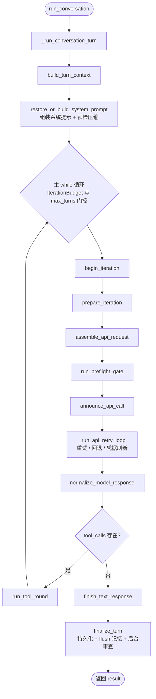
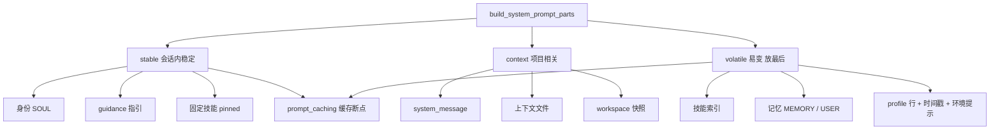
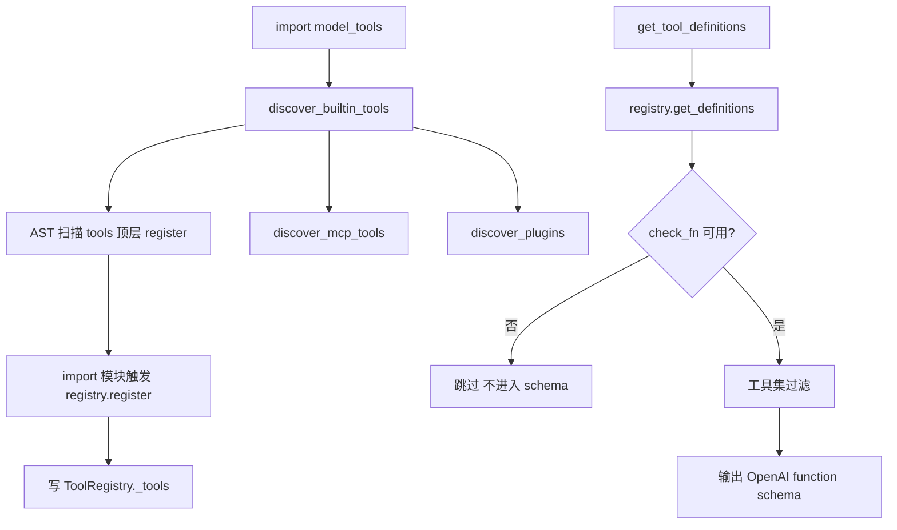
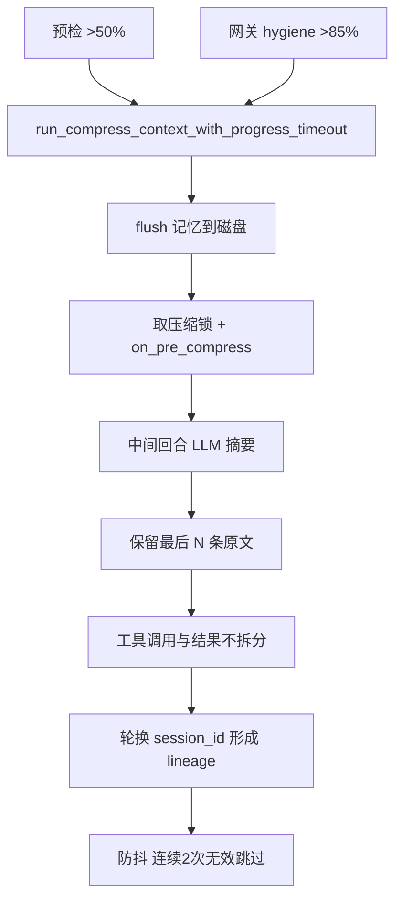
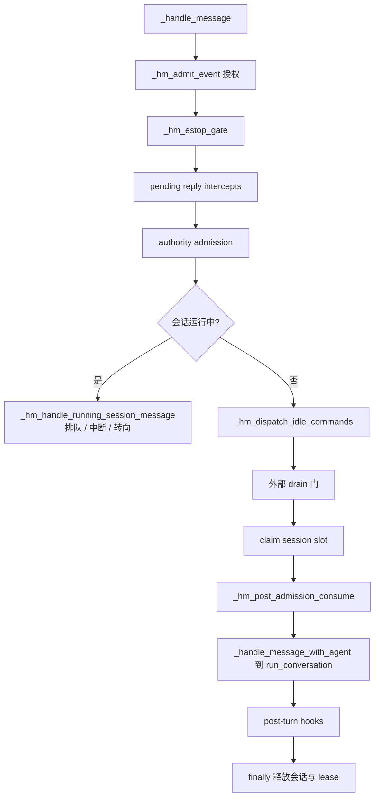
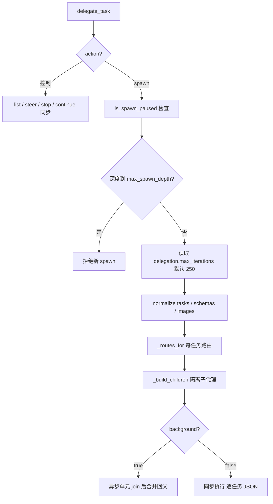
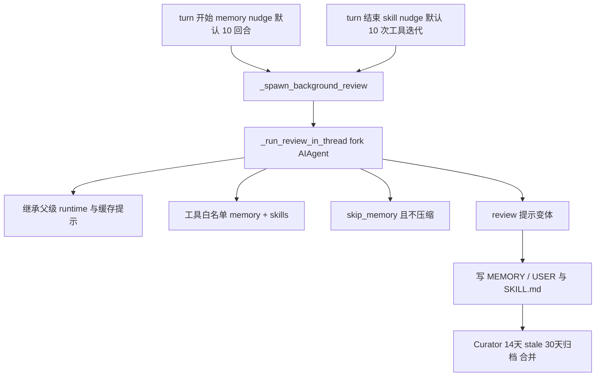
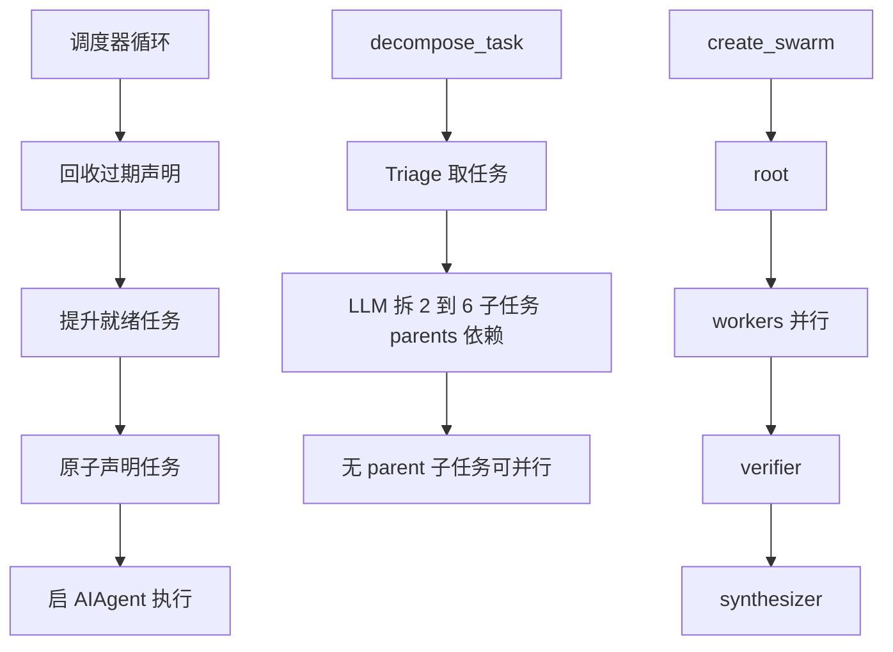

# Hermes Agent 架构与开发 一站式学习总览

> 本文把「架构原理 → 核心功能原理 → 开发实践」串成一条可循序渐进阅读的链路，作为进入源码前的第一份地图。
> 更深入的主题请按文末「学习路线」跳转到 `docs/learning/` 下对应的专题文档和 `website/docs/developer-guide/` 官方文档。

---

## 目录

1. [一页速览](#一页速览)
2. [全景：系统如何拼起来](#全景系统如何拼起来)
3. [架构原理](#架构原理)
4. [核心功能原理](#核心功能原理)
5. [开发实践步骤](#开发实践步骤)
6. [循序渐进学习路线](#循序渐进学习路线)
7. [关键文件速查表](#关键文件速查表)

---

## 一页速览

**Hermes Agent 是什么**：一个「一个 Agent 内核，跑在多个入口上」的个人 AI 智能体，由 Nous Research 开发。同一个内核同时服务 CLI、TUI、Electron 桌面端、Web 面板、ACP 编辑器，以及 Telegram / Discord / Slack / WhatsApp 等 25+ 消息平台，并通过**插件 + 技能（Skills）**扩展，而不是膨胀核心。

它最独特的点是**内置学习闭环**：从经验中创建技能 → 技能在使用中自我改进 → 主动持久化记忆 → 搜索历史会话 → 跨会话逐步加深对你的理解。

**两个贯穿所有设计决策的不变量**：

| 不变量 | 一句话 | 后果 |
|---|---|---|
| **会话内提示缓存神圣不可侵犯** | 对话中途改变历史/工具集/记忆/系统提示会打断缓存的 prompt 前缀，成倍增加费用 | 会改变系统提示状态的斜杠命令默认「下次会话生效」，唯一例外是上下文压缩；`/skills install --now` 显式选择立即生效 |
| **核心是窄腰，能力在边缘** | 每个模型工具都会在每次 API 调用中发送，所以新增*核心*工具的代价极高 | 新能力优先走 CLI 命令 + 技能、服务门控工具、插件、MCP，而不是新增核心工具 |

**一条最小链路**（记住它，后面所有章节都在放大它）：

```
入口（CLI / 网关 / ACP / Batch / API / 库）
        │  都是同一个内核
        ▼
AIAgent 主循环（run_conversation）
  组装系统提示 + 工具 schema → 解析 Provider/API 模式 → 调 LLM → 执行工具调用 → 写回会话
        │
        ▼
SQLite 会话存储（FTS5 全文检索）+ 记忆文件 + 技能库
```

---

## 全景：系统如何拼起来

### 分层架构图

```
┌────────────────────────────────────────────────────────────────────────┐
│                           入口层 Entry Points                           │
│   CLI(cli.py)   Gateway(gateway/run.py)   ACP(acp_adapter/)            │
│   Batch Runner(batch_runner.py)   API Server   Python Library          │
└──────────────────────────────┬─────────────────────────────────────────┘
                               │  全部汇聚到同一个 AIAgent
                               ▼
┌────────────────────────────────────────────────────────────────────────┐
│                      AIAgent 内核（run_agent.py facade）                │
│                                                                        │
│   ┌───────────────┐   ┌───────────────┐   ┌──────────────────────┐     │
│   │ Prompt Builder │   │ Provider 解析  │   │ Tool 分发             │     │
│   │ 系统提示组装    │   │ 3 种 API 模式 │   │ model_tools.py        │     │
│   └──────┬────────┘   └──────┬────────┘   │ registry + toolsets   │     │
│          │                   │             └──────────┬───────────┘     │
│   ┌──────┴────────┐   ┌──────┴────────┐               │                 │
│   │ 压缩 & 缓存    │   │ chat_compl.   │               ▼                 │
│   │ prompt_caching │   │ codex_resp.   │       工具后端（终端 6+ /        │
│   │ context_comp.  │   │ anthropic_msg │       浏览器 / Web / MCP / 文件）│
│   └───────────────┘   └───────────────┘                                │
└───────────────────────────────┬────────────────────────────────────────┘
                                │
                                ▼
┌────────────────────────────────────────────────────────────────────────┐
│                    持久化 & 扩展层                                       │
│   SQLite + FTS5 会话库(hermes_state.py)   MEMORY.md / USER.md          │
│   Skills(~/.hermes/skills)   Plugins(4 来源)   Cron   MCP              │
└────────────────────────────────────────────────────────────────────────┘
```

### 目录 ↔ 职责映射

| 目录 / 文件 | 职责 |
|---|---|
| `run_agent.py` | `AIAgent` facade，对外入口；真正的循环在 `agent/` |
| `agent/` | 主循环、各 turn 阶段、提示组装、压缩、Provider 解析、后台审查 |
| `cli.py` + `hermes_cli/` | 交互式 CLI、斜杠命令、配置、皮肤、profile 多路复用 |
| `gateway/` | 25+ 平台适配器、消息守卫、流式、通知、令牌锁、profile 作用域 |
| `model_tools.py` + `tools/` | 工具编排、`handle_function_call()`、工具发现/注册/工具集 |
| `toolsets.py` | 工具分组（`_HERMES_CORE_TOOLS` 核心工具清单） |
| `hermes_state.py` + 兄弟文件 | SQLite 会话/状态数据库 facade |
| `hermes_constants.py` | `get_hermes_home()` 等 profile 感知路径 |
| `plugins/` | 插件发现、native 兼容契约 |
| `cron/` | 定时调度器 |
| `acp_adapter/` | 编辑器 ACP 协议服务器 |
| `website/docs/developer-guide/` | 官方长文档 |

> 注意：这个仓库采用 **facade + siblings（兄弟文件）** 布局。曾经的「上帝文件」现在被拆成 facade（对外入口 + 被 import 的名字）+ 一组 `<stem>_<topic>.py`，每个兄弟文件只负责一个主题。**按主题找代码**用 `grep -rn "def name" <dir>/<stem>_*.py`，而不是直接读 facade。

---

## 架构原理

### 1. 两大不变量（一切设计判断的透镜）

- **提示缓存神圣**：对话中途不动历史、工具集、记忆、系统提示。唯一例外是上下文压缩；斜杠命令的状态变更默认推迟到下一会话。
- **核心窄腰**：核心工具在每个请求里都会被发送，新增核心工具的评审门槛极高。能力优先放到边缘（CLI 命令 + 技能 / 服务门控工具 / 插件 / MCP）。

### 2. 一个内核，多入口（平台无关核心）

CLI、网关、ACP、批处理、API Server 都调用**同一个 `AIAgent`**。平台差异只存在于「入口」这一层（怎么读输入、怎么展示进度），不进内核。这是靠**回调面（callback surfaces）**实现的：

| 回调 | 触发时机 | 消费方 |
|---|---|---|
| `tool_progress_callback` | 每个工具执行前后 | CLI spinner / 网关进度消息 |
| `thinking_callback` | 模型开始/结束思考 | CLI「thinking…」指示 |
| `reasoning_callback` | 模型返回推理内容 | CLI / 网关 reasoning 块 |
| `step_callback` | 每个完整 agent turn 后 | 网关 step 追踪 / ACP 进度 |
| `status_callback` | 状态变化 | ACP 状态更新 |

### 3. facade + siblings：上帝文件 → 模块

- facade 只放公开入口和被外部 import 的名字；行为一律进 siblings。
- siblings 在函数内部**晚导入 facade**，避免模块级循环导入。
- **补丁要打在「生产代码真正读取的地方」**：sibling 在函数里 `from <facade> import name`，意味着 facade 才是 seam；打在定义模块上会静默失效。
- 复杂度有硬性棘轮：新函数 CC ≤ 20、≤ 300 行、嵌套 ≤ 6；文件 ≤ 2000 行。超标的单元只能变小。

### 4. Profile 隔离

每个 `hermes -p <name>` 拥有独立的 `HERMES_HOME`、配置、记忆、会话和网关 PID；多个 profile 可并发。代码里**永不硬编码 `~/.hermes`**：路径用 `get_hermes_home()`，文案用 `display_hermes_home()`。

### 5. 足迹阶梯（Footprint Ladder）

新能力按「取能解决它的最高一级」落地：

```
扩展现有代码 → CLI 命令 + 技能 → 服务门控工具(check_fn 回答可达性/opt-in)
   → 插件 → 目录里的 MCP 服务器 → 新核心工具（最后手段）
```

### 6. 可观察、可中断、可回退

- **可观察**：每个工具调用都通过回调对用户可见。
- **可中断**：API 调用和工具执行可被用户输入 / 信号中途取消（`_interruptible_api_call` 在后台线程跑 HTTP，主线程监听中断事件）。
- **可回退**：主模型失败（429 / 5xx / 401/403）时按 `fallback_providers` 依次切换；辅助任务（vision / 压缩 / 标题）有独立的 fallback 链。

---

## 核心功能原理

### 3.1 Agent 主循环

> 一个内核驱动所有入口：每个 turn 内多轮「调 LLM → 执行工具 → 回填结果」，直到文本回复或预算耗尽。

**概述**

- **定位**：`AIAgent` 是唯一内核，CLI / 网关 / ACP / Batch / API Server 都调用它。`run_agent.py` 只是 facade，循环本体在 `agent/conversation_loop.py`，每个 turn 阶段拆到 `agent/turn_*.py`。
- **三个入口函数**：`run_conversation()` 包装 turn 边界；`_run_conversation_turn()` 是真正循环；`chat()` 是 `run_conversation` 的薄封装，只取 `final_response`。
- **统一阶段包装**：循环每一步经 `_run_phase(fn, agent, state)` 执行，统一异常/中断/退出语义（`break / continue / return`）。
- **可中断**：`_run_api_retry_loop` 在后台线程跑 HTTP，主线程监听中断事件；失败按 `fallback_providers` 回退，401/403 先尝试凭据刷新。
- **预算**：`IterationBudget` + `agent.max_turns`（默认 `None` 不限）门控 while 循环；`_budget_grace_call` 给回退一次有界收尾调用。
- **先持久化再执行**：工具轮次先把 assistant/tool-call 消息落库，再执行工具（`run_tool_round` 的持久性不变量）。


**三种 API 模式**（运行时按 Provider / 显式参数 / base_url 启发式解析）：

| 模式 | 用途 | 客户端 |
|---|---|---|
| `chat_completions` | OpenAI 兼容端点（大多数 provider） | `openai.OpenAI` |
| `codex_responses` | OpenAI Codex / Responses API | `openai.OpenAI` Responses 格式 |
| `anthropic_messages` | Anthropic 原生 Messages API | `anthropic.Anthropic` 适配器 |

**代码流程**

```
run_conversation()                              agent/conversation_loop.py:1809
  └─ _run_conversation_turn()                   agent/conversation_loop.py:1647
       ├─ _decode_inline_moa_turn()             # MoA 内联 turn（可选）
       ├─ _try_refresh_env_client_credentials() # 每 turn 刷新 .env 凭据
       ├─ build_turn_context()                  agent/turn_context.py
       │     └─ restore_or_build_system_prompt()  # 组装/恢复提示 + 预检压缩
       ├─ begin_voice_turn_route()              agent/voice_turn_route.py
       ├─ _turn_without_loop()                  # 插件阻止/提前返回时短路
       ├─ play_prelude()                        agent/turn_scripted_prelude.py
       │
       └─ 主 while 循环（api_call_count < max_iterations 且 budget.remaining > 0 或 grace）
             ├─ begin_iteration()               agent/turn_iteration_prep.py:352  # 中断/预算/一次性回退
             ├─ prepare_iteration()             agent/turn_iteration_prep.py:144  # 预算告警 + 刷新工具 schema
             ├─ assemble_api_request()          agent/turn_request_assembly.py:107 # 组装消息 + 缓存标记
             ├─ run_preflight_gate()            agent/turn_preflight_gate.py:20   # 上下文溢出 / 压缩门
             ├─ announce_api_call()             agent/turn_iteration_prep.py:307  # 进度提示
             ├─ _run_api_retry_loop()           agent/conversation_loop.py:1578   # 重试 / 回退 / 凭据刷新
             ├─ apply_retry_restarts()          agent/turn_iteration_prep.py:437  # 回退后重挂缓存标记
             ├─ normalize_model_response()      agent/turn_response_intake.py:170 # 归一化为统一消息
             ├─ 分支：
             │     ├─ tool_calls → run_tool_round()        agent/turn_tool_round.py:49     → 回循环头
             │     └─ 文本回复   → finish_text_response()   agent/turn_final_response.py:106 → 退出
             └─ 异常 → handle_outer_loop_error() agent/turn_loop_errors.py:35   # break / continue
       │
       └─ finalize_turn()                       agent/turn_finalizer.py:645
             └─ 持久化会话 + flush 记忆 + 触发后台审查 fork（self-evolution）
```

**关键结构**：`_LoopState`（`agent/conversation_loop.py` 内的 dataclass）承载 turn 级状态——`messages / api_call_count / retry_count / finish_reason / turn_exit_reason` 等；`_run_phase` 返回 `PhaseVerdict`（`action + result`），决定循环 `break/continue/return`。

**流程图**



**关键文件**

- `run_agent.py`：facade
- `agent/conversation_loop.py`：循环本体 + `_LoopState` + `_run_phase`
- `agent/turn_*.py`：各阶段
- `agent/tool_executor.py`：工具执行与 agent 级拦截


### 3.2 提示系统与 Prompt Caching

> 把身份、指引、上下文、记忆、时间戳拼成 system prompt，并用分层 + 缓存断点最大化前缀缓存命中。

**概述**

- **定位**：`agent/system_prompt.py` 的 `build_system_prompt_parts()` 组装三层；`agent/prompt_builder.py` 提供上下文文件、技能索引等输入。
- **三层结构**：`stable`（身份/指引/固定技能，会话内稳定）→ `context`（上下文文件/workspace 快照）→ `volatile`（技能索引/记忆/profile/时间戳，最易变化）。
- **字节稳定**：时间戳只到「日期 + 时区」粒度，保证当天多次 rebuild 字节一致，保住 provider 前缀缓存。
- **缓存断点**：`agent/prompt_caching.py` 打断点；`ephemeral_system_prompt` 只在 API 调用时注入，绝不进缓存。
- **上下文文件优先级**（只命中第一种）：`.hermes.md`/`HERMES.md` → `AGENTS.md` → `CLAUDE.md` → `.cursorrules`；`SOUL.md` 单独注入身份槽。
- **定制路径**：改人格改 `SOUL.md`，改仓库规则改上下文文件，加流程加技能；只有改「所有人」的组装才动 Python。
- **Prompt Surface 是代码**：真实 prompt + `tools[]` 渲染成快照提交进 `tests/fixtures/prompt_surface/`，CI 检测漂移，改快照需 hermes-agent-core 审批。

- **动态截断**：`_context_file_max_chars()` 决定上下文文件上限——显式 `context_file_max_chars` 优先，否则按模型上下文窗口动态计算（`_dynamic_context_file_max_chars`），超长文件截断后注入。


**代码流程**

```
build_system_prompt_parts(agent, system_message)      agent/system_prompt.py:751
  ┌ stable（会话内稳定 → 缓存前缀主体）
  │   ├─ _identity_parts()          # 身份（SOUL.md / 默认身份）
  │   ├─ HERMES_AGENT_HELP_GUIDANCE（有/无技能两种变体，按 skill_view 是否在 tools[] 选择）
  │   ├─ _guidance_parts()          # 工具指引、编码简报
  │   ├─ _alibaba_identity_part()   # （如适用）
  │   ├─ _auto_load_parts()         # 固定技能（pinned skills）
  │   └─ _coding_parts()            # coding prefix
  ├ context（项目 / worktree 相关，会话间可变化）
  │   ├─ 调用方 system_message
  │   ├─ _context_files_part()      # .hermes.md > AGENTS.md > CLAUDE.md > .cursorrules
  │   └─ coding workspace 快照 + trailing + post_workspace
  └ volatile（易变，放最后保住最长公共前缀）
      ├─ _skills_prompt()           # 技能索引
      ├─ _memory_parts()            # MEMORY.md / USER.md / 外部 memory block
      ├─ 插件 section（after_memory 锚点，位置固定）
      ├─ _active_profile_line() + _timestamp_line()  # profile 行 + 日期粒度时间戳
      └─ build_environment_hints()  # 运行时环境提示（RUNTIME_ENVIRONMENT_HEADING）
```

**细节**：`_context_file_max_chars()` 决定上下文文件截断上限——显式 `context_file_max_chars` 优先，否则按模型窗口动态计算（`_dynamic_context_file_max_chars`）；`_join_tier()` 用 `\n\n` 拼接每层部件。

**流程图**



**关键文件**

- `agent/system_prompt.py`：三层组装
- `agent/prompt_builder.py`：上下文文件、技能索引等输入
- `agent/prompt_caching.py`：Anthropic 缓存断点
- `scripts/ci/prompt_surface.py`：prompt surface 渲染
- `tests/fixtures/prompt_surface/`：提交的快照


### 3.3 工具系统

> 70+ 工具、35 个工具集定义（含平台 bundle），以「自注册 + 自动发现」组织，按 `check_fn` 动态决定进入模型 schema，收到 tool_calls 后经 registry 统一分发。

**概述**

- **自注册**：每个 `tools/*.py` 在 import 时调用 `registry.register(name, toolset, schema, handler, check_fn, ...)`。
- **自动发现**：`discover_builtin_tools()`（`tools/registry.py:121`）用 AST 扫描顶层 `registry.register()` 并 import，无需手工清单。
- **可用性门控**：`check_fn` 返回 False 时工具整体不出现在 schema（API key 缺失 / 服务未运行 / 依赖未装）。
- **工具集**：`toolsets.py` 分组；`_HERMES_CORE_TOOLS` 定义核心清单。
- **两条执行链路**：`todo / memory / session_search / delegate_task` 被 agent 级拦截直接改 agent 状态；其余走 `handle_function_call → registry.dispatch`。
- **插件 overlay**：`ToolRegistry._tools`（全局内置）+ `_scoped_tools`（每 profile 插件 overlay）；`_merged_tools(scope)` 合并两者。插件覆盖内置需 `override=True` 且 operator 显式 `allow_tool_override: true`。
- **统一错误包装**：异常转 `{"error": ...}` 并经 `_sanitize_tool_error()` 清洗。

**核心工具清单**（`_HERMES_CORE_TOOLS`，`toolsets.py:11`）：

- 网络：`web_search`、`web_extract`
- 终端/进程：`terminal`、`process_manage`
- 文件：`read_file`、`write_file`、`patch`、`search_files`
- 视觉/图像：`vision_analyze`、`image_generate`
- 技能：`skills_list`、`skill_view`、`skill_manage`
- 浏览器：`browser_exec`、`browser_cdp`、`browser_dialog`、`browser_vault`
- 语音：`text_to_speech`
- 记忆/搜索：`todo_list`、`memory`、`session_search`、`clarify`
- 编程/委派：`execute_code`、`delegate_task`
- 定时：`cronjob_manage`
- 连接器：`manage_connections`、`computer_use`
- Kanban：`kanban_show/list/complete/block/request_review/request_changes/heartbeat/comment/create/link/unblock/attach/attach_url/attachments`


**代码流程**

```
【注册与发现】
import model_tools
  └─ discover_builtin_tools()              tools/registry.py:121
       ├─ AST 扫描 tools/*.py 顶层 register
       ├─ import 模块 → registry.register()  tools/registry.py:845
       │     └─ 校验 schema → 检查 shadow/override → 写 ToolRegistry._tools
       ├─ discover_mcp_tools()             tools/mcp_tool.py
       └─ discover_plugins()               hermes_cli/plugins.py
get_tool_definitions()                     model_tools.py:227
  └─ registry.get_definitions()            tools/registry.py:1034
       ├─ 每个 entry 跑 check_fn() → False 跳过（整体不出现在 schema）
       ├─ 工具集过滤（enabled / disabled_toolsets）
       └─ 输出 OpenAI function schema

【单次调用分发】
handle_function_call(name, args)           model_tools.py:907
  ├─ coerce_tool_args() + _LEGACY_TOOL_ALIASES
  ├─ hosted_tool_refusal()                 # 托管作用域默认拒绝
  ├─ _dispatch_bridge_tool()               # Tool Search bridge 解包
  ├─ 连接器检查（manage_connections / connectors__<conn>__<tool>）
  ├─ _apply_request_middleware() + _pre_dispatch_guards() + 审批
  ├─ _execute_tool() ──► registry.dispatch()   tools/registry.py:1084
  │     ├─ hosted_tool_refusal()           # 二次 deny-by-default
  │     ├─ get_entry()                     # 查 ToolEntry（含插件 overlay 回退）
  │     ├─ check_tool_args() + flag_unknown_args()  # 参数校验
  │     ├─ handler(args, **kwargs)         # 同步 / _run_async 桥接 async
  │     └─ _normalize_handler_result()     # 只允许 string 或 multimodal envelope
  └─ _emit(post_tool_call hook) + _apply_transform_tool_result_hook()
```

**细节**：`ToolEntry`（`tools/registry.py:216`）携带 `name / toolset / schema / handler / check_fn / is_async / max_result_size_chars / execution_timeout / compat_args / self_checked_args`；`register()` 对跨工具集同名 shadow 直接拒绝，除非 `override=True` 且有 operator 授权。

**流程图**



**关键文件**

- `tools/registry.py`：注册中心
- `model_tools.py`：`get_tool_definitions`、`handle_function_call`
- `toolsets.py`：工具分组与核心清单
- `agent/tool_executor.py`：agent 级拦截
- `tools/mcp_tool.py`：MCP 工具发现


### 3.4 会话存储、记忆与压缩

> SQLite + FTS5 持久化会话与全文检索，`MEMORY.md`/`USER.md` 保存跨会话事实，上下文逼近上限时压缩中间回合、轮换 session。

**概述**

- **存储**：`hermes_state.py`（facade）+ `hermes_state_*.py` 兄弟文件；会话有 lineage（压缩产生父/子链）、按平台隔离、原子写与争用处理。
- **记忆**：`MEMORY.md`/`USER.md` 注入系统提示 volatile 层；外部 memory provider（插件）通过 `on_pre_compress` 在丢弃消息前抽取。
- **压缩触发**：预检（>50% 上下文）与网关 hygiene（>85%，turn 间更激进）。
- **压缩过程**：先 flush 记忆 → 取压缩锁 → 中间回合 LLM 摘要 → 保留最后 N 条原文（`compression.protect_last_n` 默认 20）→ 工具调用/结果对不拆分 → 轮换 `session_id`（子会话）。
- **防抖动**：连续 2 次无效压缩（节省 <10%）跳过；摘要失败冷却 600s。
- **搜索**：`session_search` 用 FTS5 + LLM 摘要做跨会话回溯。

**SQLite 结构**（`hermes_state_common.py` 的 `SCHEMA_SQL`）：

- 核心表：`sessions`、`messages`、`system_prompts`、`session_model_usage`、`session_admissions`、`worker_executions`、`worker_receipts`、`gateway_routing`、`gateway_hygiene_state`、`conversation_generations`、`state_meta`、`schema_version`
- 全文检索：两张 FTS5 虚拟表——`messages_fts`（unicode61，英文词切分）与 `messages_fts_trigram`（trigram，CJK 子串检索）；`MAX_FTS5_QUERY_CHARS = 2048` 限制查询长度


**代码流程**

```
触发：预检 >50% | 网关 hygiene >85%
  └─ run_compress_context_with_progress_timeout()   agent/conversation_compression.py:1170
       ├─ flush 记忆到磁盘（防数据丢失）
       ├─ 取压缩锁（原子，基于 state.db）→ 通知外部 memory provider（on_pre_compress）
       ├─ 中间回合 → LLM 摘要（agent/context_compressor.py）
       ├─ 保留最后 N 条原文（compression.protect_last_n，默认 20）
       ├─ 工具调用 / 结果消息对不拆分
       ├─ 轮换 session_id → 新 SQLite 行（父指向旧会话，形成 lineage）
       └─ 防抖：连续 2 次无效压缩（节省 <10%）跳过；摘要失败冷却 600s
```

**细节**：`CompressionCommitFence`（`agent/conversation_compression.py:454`）做提交栅栏，配合 `_await_worker_within_budget` / `_cancel_or_join_worker` 管理压缩 worker 的超时与取消；`_claim_compressor_attempt` 用 generation 号防止过期尝试写入。

**流程图**



**关键文件**

- `hermes_state.py` + `hermes_state_*.py`：SQLite 会话库
- `agent/context_compressor.py`：摘要算法
- `agent/conversation_compression.py`：压缩编排 + 会话轮换
- `agent/memory_manager.py`、`agent/memory_provider.py`：记忆编排与抽象


### 3.5 消息网关

> 一个长驻进程承载 25+ 平台适配器，把各平台消息统一路由到同一 AIAgent，处理授权、斜杠命令、Hook、Cron ticking 与后台维护。

**概述**

- **主控制器**：`GatewayRunner`（`gateway/run.py:3297`）由 20+ 个职责 mixin 聚合（`GatewayInboundMixin` / `GatewayTurnMixin` / `GatewayAgentCacheMixin` …）。
- **平台无关核心**：平台差异只在入口；内核通过回调面（`tool_progress_callback` / `step_callback` / `reasoning_callback` 等）推送进度。
- **会话权威受理**：消息先走授权（allowlist + DM 配对）→ 进入 admission/FIFO 队列，避免重复起 agent。
- **busy 处理**：会话运行中，新消息走排队 / 中断 / 转向（steer / interrupt）。
- **会话槽声明**：`_claim_active_session_slot()` 在任何 await 前先占槽，防并发重复启动 agent。
- **turn lease**：按（routing key, run generation）释放，保证重启/置换后不会误释放新 turn 的槽。
- **兜底恢复**：owner 死掉时 `prompt.resolve_unknown` 把未知 turn 标记为 interrupted，不重放。

**后台维护**（`gateway/run.py` housekeeping，`_start_gateway_housekeeping`）：

- 频道目录刷新、paste 清理、cron misfire 补跑、Curator、插件更新检查
- `state.db` 维护、FTS 延迟重试、memory 修剪、checkpoint 修剪
- cron ticker 默认每 60s tick 一次（`_start_cron_ticker(..., interval=60)`）


**代码流程**

```
_handle_message(event)                      gateway/run_inbound.py:1350
  ├─ _hm_admit_event()                      # 授权（allowlist / DM 配对）+ 媒体/转写
  ├─ _hm_estop_gate()                       # 紧急停止门（暂停通知）
  ├─ _hm_pending_reply_intercepts()         # 待处理交互拦截（clarify / confirm）
  ├─ _hm_authority_admission()              # 会话权威受理（admission_id / FIFO）
  ├─ 清理泄漏 / reaped 的运行中 agent 槽位
  ├─ 会话运行中 → _hm_handle_running_session_message()  # 排队 / 中断 / 转向
  ├─ _hm_dispatch_idle_commands()           # 空闲态斜杠命令
  ├─ 外部 drain 门（维护期拒绝新 turn）
  ├─ _claim_active_session_slot()           # 防同一会话重复起 agent
  ├─ _hm_post_admission_consume()           # 插件消费（fail-open，每消息一次）
  ├─ _handle_message_with_agent()           # 建/取 AIAgent → run_conversation
  ├─ _run_post_turn_hooks()                 # goal judge 等 post-turn hook
  └─ finally:
       ├─ _restore_pending_one_turn_model_override()  # 恢复 /moa、/model --once
       ├─ _clear_durable_active_turn()                # 清 durable 活跃 turn 标记
       └─ _release_running_agent_state() + _release_turn_lease()  # 按 run_generation 释放
```

**细节**：`_hm_authority_admission`（`gateway/run_inbound.py:1289`）生成带 `admission_id` 的受理行；`TurnLeaseTimeoutError` 表示租约超时，消息被拒绝而非误跑。

**流程图**



**关键文件**

- `gateway/run.py`：`GatewayRunner` 主控制器 + 各 mixin
- `gateway/run_inbound.py`：`_handle_message` 入口
- `gateway/run_turn.py`、`gateway/turn_executor.py`：turn 执行与租约


### 3.6 技能 / 插件 / Cron / 子代理 / Hooks

> 「能力在边缘」的四类机制 + 可观察生命周期的 Hooks。

**概述**

- **Skills**：按需加载的知识文档，渐进式披露（`skills_list` → `skill_view(name)` → `skill_view(name, path)`）；遵循 agentskills.io；Agent 可用 `skill_manage` 自建/修复/删除；支持平台过滤与工具集依赖条件激活。
- **Plugins**：4 个发现来源（捆绑 `<repo>/plugins/`、用户 `~/.hermes/plugins/`、项目 `.hermes/plugins/`、pip entry-points）；可注册工具/Hooks/CLI 命令；memory provider 与 context engine 是「单选」特化类型。
- **Cron**：一级 agent 任务（非 shell 任务），JSON 存储，多调度格式，可挂技能与脚本，投递任意平台。
- **Subagent**：`delegate_task` 生成隔离上下文子代理并行干活；受 `delegation.max_iterations`（250）、`max_spawn_depth`（1）、`max_concurrent_children`（10）约束。
- **Hooks**：观察器钩子（见 `observer-hooks.md`），插件通过 context API 注册。

**代码流程**

```
delegate_task(goal | tasks=[...], action=...)        tools/delegate_tool.py:604
  ├─ action=list/steer/stop/continue → 控制分支（同步，绕过 pause 与 depth）
  ├─ is_spawn_paused() → 拒绝新 spawn（TUI / delegation.pause RPC）
  ├─ 深度检查：_delegate_depth >= delegation.max_spawn_depth（默认 1）→ 拒绝
  ├─ _load_config()：delegation.max_iterations（默认 250）权威，忽略调用方 max_iterations
  ├─ _normalize_task_list() / _coerce_task_schemas() / _coerce_task_images()
  ├─ _routes_for()：每个任务一条路由（delegation.backend / credentials_cfg）
  ├─ refuse_waiting_duplicates() + _oneshot_spawn_budget()
  ├─ create_live_transcripts()              # 实时日志 side channel，不影响 prompt 缓存
  ├─ _build_children()                      # 构造隔离上下文的子 AIAgent
  └─ 调度：
        ├─ background=true  → 异步单元，join 后以一条合并消息回父
        └─ background=false → 同步执行，逐任务返回 JSON
```

**细节**：子代理生命周期由 `agent/subagent_lifecycle.py` 的 `SubagentLifecycleService` 管理（`SubagentState` 枚举、`SubagentHandle`、`SubagentLaunchRequest`）；Cron 执行见 `cron/scheduler.py:2540` 的 `run_job`（每 job 独立 session + 看门狗 + teardown）。

**Cron 执行流**（`cron/scheduler.py`）：

```
run_one_job()（cron/scheduler.py:2795，共享 seam）
  ├─ 无 execution_id → create_execution()（持久化 attempt）
  ├─ _launch_external_cron_worker()：重启安全的 detached worker 接管
  └─ 未接管 → _run_one_job_body()：执行 → 保存输出 → 投递 → mark_job_run()
run_job()（cron/scheduler.py:2540，每 job 本体）
  ├─ no_agent → run_canonical_job()
  ├─ _prepare_job_prompt → _load_cron_job_config → _resolve_cron_agent_setup
  ├─ _open_cron_session_db → _construct_cron_agent → _run_agent_with_watchdog
  └─ finally：_teardown_cron_agent()（防 fd/EMFILE 泄漏）
```


**流程图**



**关键文件**

- `skills/`、`tools/skill_manager_tool.py`、`tools/skills_tool.py`
- `plugins/`、`hermes_cli/plugins.py`
- `cron/`、`cron/scheduler.py`
- `tools/delegate_tool.py`、`agent/subagent_lifecycle.py`
- `website/docs/developer-guide/observer-hooks.md`


### 3.7 自进化闭环

> 内置学习回路：压缩 → 记忆 → 技能 → 归档，由回合结束后的后台审查 fork 驱动，主动沉淀经验。

**概述**

- **两级计数器**：Memory Review 每 N 个用户回合（默认 10）、Skill Review 每 N 次工具迭代（默认 10）触发。
- **后台 fork**：`_spawn_background_review` 创建 AIAgent 子实例在后台线程并行，不阻塞用户下一轮。
- **继承与隔离**：继承父级 runtime 与缓存系统提示（共享 prompt cache）；工具白名单仅 memory+skills；`skip_memory=True`、不压缩、抑制状态输出。
- **主动式 Skill Review**：提示要求「大部分会话应产生至少一次技能更新」。
- **Curator**：`agent/curator.py` 周期维护——默认 7 天跑一次（`interval_hours=168`、`min_idle_hours=2`），14 天 unused 标记 stale，30 天归档 `.archive/`；`consolidate=False`（LLM umbrella 合并默认关闭）、`prune_builtins=False`；cron 引用自动重写。
- **离线闭环**：`trajectory_compressor.py` 把生产轨迹压缩成训练数据。

- **记忆默认值**（`config_defaults.py`）：`memory_enabled=True`、`user_profile_enabled=True`、`memory_char_limit=2200`、`user_char_limit=1375`、`write_approval=False`（记忆写入无需审批）、`provider=""`（外部 memory provider 关闭，内置为主）；`memory.nudge_interval=10` 触发 Memory Review，`skills.creation_nudge_interval=10` 触发 Skill Review。


**代码流程**

```
turn 开始 agent/turn_context.py   → _memory_nudge_interval 命中（默认 10 个用户回合）
turn 结束 agent/turn_finalizer.py → _skill_nudge_interval  命中（默认 10 次工具迭代）
        │
        ▼
_spawn_background_review(messages_snapshot, review_memory, review_skills)   agent/background_review.py
        │
        ▼
_run_review_in_thread()：创建 AIAgent fork，后台线程并行
  ├─ 继承父级 runtime（provider / model / base_url / credentials）
  ├─ 继承缓存系统提示（_cached_system_prompt）→ 与父级共享 prompt cache
  ├─ 工具白名单：仅 memory + skills（get_tool_definitions(enabled_toolsets=["memory","skills"])）
  ├─ skip_memory=True（审查交互不写回用户记忆）
  ├─ suppress_status_output=True / compression_enabled=False
  └─ 提示变体：_MEMORY_REVIEW_PROMPT / _SKILL_REVIEW_PROMPT / _COMBINED_REVIEW_PROMPT
        │
        ▼
  写 MEMORY.md / USER.md（跨会话事实）
  创建 / 更新 SKILL.md（provenance: agent / foreground）
        │
        ▼
  Curator（agent/curator.py，周期守护）
    ├─ 14 天 stale → 30 天归档 .archive/
    ├─ consolidate 开启时 LLM 合并窄技能 → umbrella 技能
    └─ 自动重写 cron 引用
```

**细节**：触发点分别是 `agent/turn_context.py`（turn 开始）与 `agent/turn_finalizer.py`（turn 结束）对计数器的检查；审查 fork 的三种提示变体决定「只记忆 / 只技能 / 两者」哪种审查。

**流程图**



**关键文件**

- `agent/background_review.py`：后台审查 fork
- `agent/curator.py`：技能库维护
- `agent/turn_context.py`、`agent/turn_finalizer.py`：审查触发点
- `agent/memory_manager.py`、`agent/memory_provider.py`：记忆编排
- `trajectory_compressor.py`：离线轨迹压缩


### 3.8 任务规划：Kanban + Subagent

> 两套并行规划系统：Kanban 持久化跨会话任务队列，Subagent 单会话内存级并行委派。

**概述**

- **Kanban 调度器**：常驻循环——回收过期声明 → 提升就绪任务 → 原子声明 → 启 AIAgent 执行；数据在 `~/.hermes/kanban.db`。
- **任务分解**：`decompose_task` 用辅助 LLM（kanban decomposer）把 Triage 任务拆成 2–6 个带 `parents` 依赖的子任务；无 parent 可并行；不可拆则 `fanout:false`。
- **Swarm 拓扑**：`create_swarm` 一次创建树形图（root → 并行 workers → verifier → synthesizer），用 `task_comments` 里的结构化 JSON 评论做共享黑板。
- **Subagent**：`delegate_task` 隔离上下文并行派发（详见扩展系统）。

**代码流程**

```
【调度器常驻循环】hermes_cli/kanban.py
  ├─ 回收过期声明（kanban.dispatch_stale_timeout_seconds，默认 4h 无心跳）
  ├─ 提升就绪任务（parents 全部完成 → ready）
  ├─ 原子声明任务
  └─ 为每个声明到的任务启动 AIAgent

【任务分解】decompose_task()  hermes_cli/kanban_decompose.py:271
  ├─ 从 Triage 列取任务
  ├─ 辅助 LLM（kanban decomposer）拆 2–6 个子任务（parents[] 表达依赖）
  ├─ 无 parent 子任务可并行
  └─ 不可拆 → fanout:false，保持单任务

【Swarm 拓扑】create_swarm()  hermes_cli/kanban_swarm.py:77
  planning root（立即完成）
    ├─ 并行 specialist workers（ready）
    └─ verifier（等所有 workers）
         └─ synthesizer（等 verifier）
  共享黑板：task_comments 中的结构化 JSON 评论
```

**细节**：连续失败超过 `kanban.failure_limit`（默认 2）自动 block；通过 `HERMES_KANBAN_BOARD` 实现 Board 级隔离；工人工具（`tools/kanban_tools.py`）仅在调度器模式或启用 kanban toolset 时可见。

**流程图**



**关键文件**

- `hermes_cli/kanban.py`：Kanban 调度器
- `hermes_cli/kanban_decompose.py`：任务分解
- `hermes_cli/kanban_swarm.py`：Swarm 拓扑
- `tools/kanban_tools.py`：工人工具
- `tools/delegate_tool.py`：子代理委派


---

## 开发实践步骤

### 4.1 环境准备与激活

1. 依赖：Python 3.14（`>=3.14,<3.15`，由 PM 提供）、Node.js（PM pin 或 `>=26`）、pnpm（`pm/lock.json` 精确 pin）。
2. 先选一个**隔离的 `HERMES_HOME` / `HERMES_RUNTIME_DIR`**，避免实验代码迁移生产数据。
3. 每个新 shell 在仓库根目录激活：

```bash
source ./activate        # bash/zsh
source ./activate.fish   # fish
. .\activate.ps1         # PowerShell

hermes --version         # 验证：跑的是当前 checkout
```

   激活会走 setup 的 runtime-only 路径，同步依赖并定义一个仅限本 worktree 生效的 `hermes` 函数。

4. 不想激活 shell 就单条命令执行：`scripts/run-in-hermes-env CMD...`。
5. 测试环境另建独立解释器（`just setup` 或手动 `python -m pm.build_env --source . --out .venv --group dev --group test`），**绝不用裸 pip/uv 改动 PM 环境**。

### 4.2 日常开发命令（`just`）

| 命令 | 作用 |
|---|---|
| `just` | 列出全部开发者命令 |
| `just setup` | 构建 runtime + test 环境 |
| `just check` | 跑 CI 全部阻塞性 lint（`scripts/check`）；`--only health` 只选 health |
| `just fix` | 用 pinned ruff `--fix` + `pnpm -r fix` |
| `just test <paths>` | `scripts/run_tests.sh`，**拒绝无路径启动** |
| `just test-all` | 全量 Python 测试 |
| `just js-install` / `check-js` / `test-js` | JS workspace |
| `just desktop` / `just tui` | 桌面 / TUI dev server |
| `just docs-install` / `docs-build` | 网站 |
| `just lock` | `pyproject.toml` 变更后刷新 `uv.lock` 并重同步 |
| `just check-repo-guards` | 历史 / 贡献者 / 供应链 / uv.lock 检查 |

### 4.3 找代码的方法

- 按主题 grep 兄弟文件：`grep -rn "def name" <dir>/<stem>_*.py`。
- 每个区域有独立 `AGENTS.md`（见根 `AGENTS.md` 的 Routing Table），进去前先读。
- 想确认某个「看似 bug」是不是故意设计：`git log -p -S "<symbol>"` 查意图。

### 4.4 修改与提交规范

- 行为进 sibling，不进 facade；内部路径不导出 re-export shim，搬符号要同时修文档。
- 机器事实与可执行文件查找走 `hermes_platform`；路径不硬编码 `~/.hermes`。
- 新配置键 / 斜杠命令必须随 PR 带上文档（`tests/ci/test_docs_drift.py` 会查）。
- 改 `pyproject.toml` 后跑 `hermes pm lock` 并提交 `uv.lock`。
- 不要新增 core/plugin 交叉引用（`scripts/boundary_lint.py`）。
- 不要引入新 `HERMES_*` 环境变量存非机密配置（行为进 `config.yaml`，机密进 `.env`）。

### 4.5 测试

- 永远用 `scripts/run_tests.sh`，**不要裸 `pytest`**。
- 行为契约测试，不要 change-detector / 读源码式测试。
- 测试不写 `~/.hermes/`；主机相关行为用 `@pytest.mark.platforms(...)`，不伪造 `sys.platform`。
- 快速跑：`just test tests/agent/ -v`。

### 4.6 提交前检查与 PR 流程

```bash
just check          # 等价 python scripts/check，跑 CI 全部阻塞 lint
just test <paths>   # 跑相关测试
just lock           # 若改过 pyproject.toml
```

- 可选：`python scripts/check --install-hook pre-push` 在每次 push 前自动检查。
- 改到 prompt surface 时重新渲染快照并一起提交：`scripts/run-in-hermes-env python scripts/ci/prompt_surface.py render`。
- PR 前 rebase 到 `main`（从陈旧分支 squash 会静默回滚新修复）；每个修复配 1–2 个不变量测试，并在 base 上证明它们会变红。
- 维护者 PR 流程见 `CONTRIBUTING.md`（维护者用 `hermes-agent-dev` skill）。

---

## 循序渐进学习路线

按这个顺序读，难度和深度递增：

1. **本文档** —— 全局地图 + 8 个核心功能点的「概述 + 代码流程 + Mermaid 流程图」（见上方「核心功能原理」）。
2. `docs/learning/architecture-learning-guide.md` —— 系统架构图 + 核心模块详解 + 关键流程。
3. `docs/learning/project-structure-and-core-files.md` —— 目录与核心文件职责。
4. `docs/learning/core-architecture-principles.md` —— Skills / Plugins / Cron / Subagent / Hooks / Tools 原理。
5. `docs/learning/task-planning-system.md` —— Agent 主循环、Kanban、Subagent 协作。
6. `docs/learning/self-evolution-learning-system.md` —— 压缩 → 记忆 → 技能 → 归档的闭环与后台审查。
7. 官方深度文档（`website/docs/developer-guide/`）：
   - `architecture.md`（顶层地图）→ `agent-loop.md`（主循环）→ `tools-runtime.md`（工具）→ `prompt-assembly.md`（提示）→ `gateway-internals.md`（网关）。
8. 动手：挑一个 `tools/` 下的小工具或一个 skill，顺着 registry → dispatch 链路读一遍，再跑 `just test`。

---

## 关键文件速查表

| 文件 | 职责 |
|---|---|
| `run_agent.py` | `AIAgent` facade（循环本体在 `agent/conversation_loop.py` + `agent/turn_*.py`） |
| `agent/prompt_builder.py` | 系统提示三层组装 |
| `agent/context_compressor.py` | 默认压缩引擎（摘要算法） |
| `agent/prompt_caching.py` | Anthropic 缓存断点 |
| `agent/background_review.py` | 后台 Memory/Skill 审查 fork |
| `agent/curator.py` | 技能库自动老化 + LLM 合并 |
| `model_tools.py` | 工具 schema 收集与 `handle_function_call()` 分发 |
| `tools/registry.py` | 工具注册中心（自注册 + 自动发现） |
| `toolsets.py` | 工具分组与 `_HERMES_CORE_TOOLS` |
| `hermes_state.py` | SQLite + FTS5 会话库 facade |
| `hermes_constants.py` | profile 感知路径（`get_hermes_home()`） |
| `cli.py` + `hermes_cli/` | CLI 编排器 + mixins |
| `gateway/run.py` | 消息网关入口 |
| `plugins/` | 插件发现与兼容契约 |
| `cron/` | 定时调度器 |
| `acp_adapter/` | 编辑器 ACP 服务器 |
| `scripts/check` | 本地阻塞 lint（= CI 检查） |
| `scripts/run_tests.sh` | 测试标准入口 |
| `website/docs/developer-guide/` | 官方长文档 |

---

## 参考

- 根目录 `AGENTS.md` —— 全局规则 + Routing Table。
- `CONTRIBUTING.md` —— 环境、命令、测试、PR 流程全貌。
- `README.zh-CN.md` —— 特性与快速入门。
- `website/docs/developer-guide/architecture.md` —— 官方顶层架构图。
