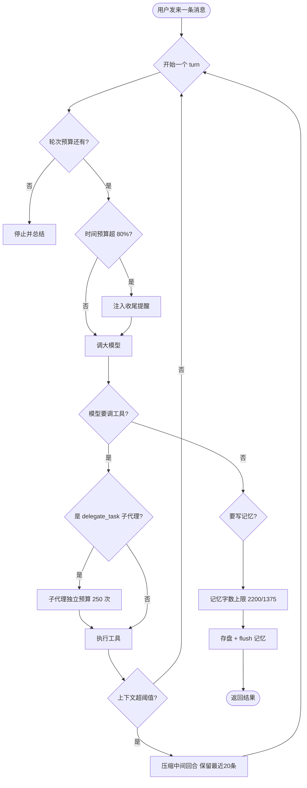
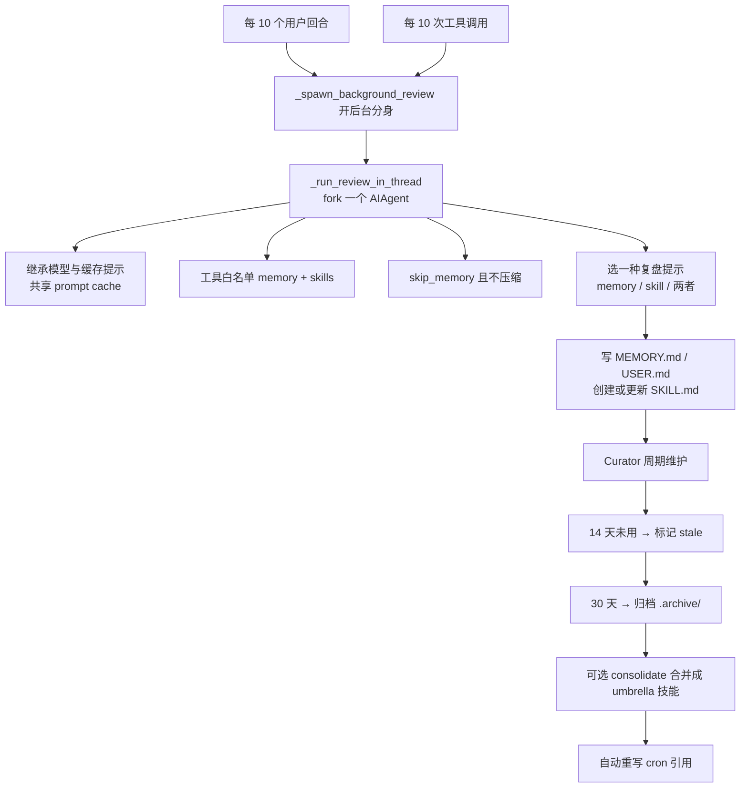
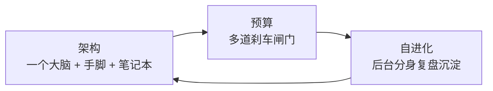

# Hermes 小白入门指南：架构 · 预算 · 自进化

> 用大白话讲清楚 Hermes 最核心的三件事：它怎么拼起来（架构）、怎么不跑飞不烧钱（预算）、怎么越用越聪明（自进化）。
> 每个部分先给类比，再给流程图，最后给一张「代码地图」方便你按图索骥。

---

## 1. 整体架构原理

### 1.1 一个类比：大脑 + 手脚 + 笔记本

把 Hermes 想象成一个「数字员工」：

| 部件 | 类比 | 实际代码 |
|---|---|---|
| **大脑** | 思考、决策 | `AIAgent`（`run_agent.py` facade + `agent/`） |
| **手脚** | 干活：跑命令、读文件、上网、浏览器 | `tools/`（70+ 工具） |
| **笔记本** | 记住对话和历史 | SQLite 会话库（`hermes_state.py`） |
| **技能手册** | 沉淀「怎么做」的 SOP | Skills（`~/.hermes/skills/`） |
| **前台秘书** | 对接 Telegram / CLI / 桌面端等入口 | 网关 / CLI / ACP（`gateway/`、`cli.py`） |

**关键点**：大脑只有一个，所有入口共用同一个大脑；差别只在「怎么跟用户说话、怎么展示进度」，不在「怎么思考」。这样写一次逻辑，处处可用。

### 1.2 分层结构图

```
┌────────────────────────────────────────────────────────────┐
│ 入口层（怎么和用户对话）                                      │
│  CLI(cli.py)  网关(gateway/run.py)  ACP(acp_adapter/)       │
│  批处理(batch_runner.py)  API Server   Python 库            │
└────────────────────────────┬───────────────────────────────┘
                             │ 全部调用同一个大脑
                             ▼
┌────────────────────────────────────────────────────────────┐
│ 大脑 AIAgent（run_agent.py facade，循环在 agent/）           │
│  ┌──────────────┐ ┌──────────────┐ ┌──────────────────┐    │
│  │ 组装提示      │ │ 解析模型/API  │ │ 分发工具          │    │
│  │ prompt_builder│ │ 3 种 API 模式│ │ model_tools.py    │    │
│  └──────┬───────┘ └──────┬───────┘ └────────┬─────────┘    │
│         └──────── 压缩 & 缓存（prompt_caching）┘             │
└────────────────────────────┬───────────────────────────────┘
                             │
          ┌──────────────────┼──────────────────┐
          ▼                  ▼                  ▼
   ┌────────────┐   ┌──────────────┐   ┌──────────────┐
   │ 会话/记忆    │   │ 工具手脚       │   │ 技能/插件/   │
   │ SQLite+FTS5 │   │ 终端/浏览器/  │   │ Cron/子代理  │
   │ MEMORY/USER │   │ Web/MCP/文件  │   │ /Hooks      │
   └────────────┘   └──────────────┘   └──────────────┘
```

### 1.3 两条「铁律」（理解了它们，就理解了 Hermes 的取舍）

1. **提示缓存神圣不可侵犯**：大模型按「前缀」缓存计费——对话开头不变就能省一大笔钱。所以对话中途**绝不**改动历史/工具集/系统提示；唯一的例外是「上下文压缩」。会改状态的斜杠命令默认「下个会话才生效」。
2. **核心窄腰，能力在边缘**：每个工具每次请求都要发给模型，所以核心工具越少越好。新能力优先做成「命令 + 技能 / 插件 / MCP」，而不是塞进核心。

### 1.4 一个最小回合（大白话）

```
你发消息 → 秘书（入口）把消息交给大脑
        → 大脑组装提示 + 挑工具 → 问大模型
        → 模型说「我要用 XX 工具」→ 大脑派手脚去执行
        → 结果写回笔记本 → 再问模型下一步
        → 直到模型给出纯文字回复 → 存盘、更新记忆、返回给你
```

---

## 2. 预算机制

### 2.1 为什么要预算

Hermes 是「会自己跑多步」的智能体，几步、几十步甚至上百步都可能。如果没有刹车，可能：

- 一次任务跑太多轮，烧钱；
- 一个子代理跑飞、无限递归；
- 上下文无限膨胀，每轮都变贵；
- 一个 turn 卡死半小时。

预算就是这些场景下的**多道刹车闸门**。

### 2.2 六道预算闸门（一张表看懂）

| # | 闸门 | 管什么 | 默认值 | 在哪配 |
|---|---|---|---|---|
| 1 | 轮次预算 | 一个 turn 最多调多少次模型 | `agent.max_turns` 默认不限 | CLI `--max-turns` / env `HERMES_MAX_ITERATIONS` |
| 2 | 子代理预算 | 每个子代理最多迭代几次 | `delegation.max_iterations = 250` | `config.yaml` |
| 3 | 时间预算 | 一个 turn 的墙上时钟上限 | `agent.run_budget_seconds` 默认关 | `config.yaml` |
| 4 | 上下文/Token 预算 | 历史太长就压缩 | 预检 >50%、网关 >85% | `compression.*` |
| 5 | 记忆字数预算 | 记忆文件写多长 | `memory_char_limit=2200`、`user_char_limit=1375` | `config.yaml` |
| 6 | 其它护栏 | goal/loop/委派摘要 | `goals.max_turns=20`、`loops.max_ticks=100`、`max_summary_chars=24000` | `config.yaml` |

### 2.3 轮次预算怎么算（`agent/iteration_budget.py`）

每个 `AIAgent`（父代理和每个子代理）各自拿一个计数器 `IterationBudget`：

```
父代理：IterationBudget(max_turns)      # 默认不限（sys.maxsize）
子代理：IterationBudget(250)            # delegation.max_iterations，独立算
```

- `consume()`：每轮尝试扣 1，扣完返回 False → 停止。
- `refund()`：`execute_code`（程序化调用工具，RPC 风格很便宜）这轮会**退回来**，不占预算。
- 父 + 子代理的轮次是**分开**算的，所以总数可以超过父代理上限（每个子代理自己封顶 250）。
- `budget_warning_ratio`：可选，设 0.75 表示在额度用到 75% 时给模型发一次「快没额度了」的提醒。

### 2.4 时间预算（`run_budget_seconds`）

- 默认关闭（`None`）。
- 开启后，一个 turn 若超过预算的 **80%**，会注入一条一次性「时间快到了，尽快收尾」的提示（`_maybe_inject_run_budget_wrapup`）。
- 到点仍没结束 → 收尾返回。

### 2.5 上下文预算（最影响钱的一道）

大模型按「每轮发送的 token 数」计费，所以历史越长越贵。Hermes 用**压缩**来控制：

```
历史长度
  ├─ 超过窗口 50%  → 预检触发压缩（turn 开始前）
  └─ 超过窗口 85%  → 网关更激进地压缩（turn 之间）
```

压缩做的事：把「中间对话」总结成摘要，只保留最近 20 条原文（`protect_last_n=20`），工具调用/结果不拆开，然后换个新 `session_id`（父→子 lineage）。

### 2.6 预算机制全景流程图



### 2.7 预算代码地图

| 想看什么 | 去哪看 |
|---|---|
| 迭代计数器 | `agent/iteration_budget.py`（`IterationBudget`） |
| turn 限额解析 | `hermes_cli/cli_init_mixin.py:298`（`_init_turn_limits`） |
| 默认值 | `hermes_cli/config_defaults.py`（`agent.max_turns`、`delegation.*`、`goals.*`、`loops.*`） |
| 预算提醒注入 | `agent/turn_iteration_prep.py:48`（`_maybe_inject_iteration_budget_warning`）、`agent/conversation_loop.py:126`（`_maybe_inject_run_budget_wrapup`） |
| 压缩阈值 | `agent/turn_preflight_gate.py`、`agent/conversation_compression.py` |

---

## 3. 自进化机制

### 3.1 一个类比：实习生 → 老师傅

Hermes 有一个「内置学习回路」，像实习生把经验一点点变成自己的：

1. **压缩**：对话太长，先做「课堂笔记」（把中间对话总结成摘要）。
2. **记忆**：把「关于你的长期事实」写进永久笔记本（`MEMORY.md` / `USER.md`）。
3. **技能**：把「这次是怎么把事办成的」写成可复用的 SOP（`SKILL.md`）。
4. **归档**：很久没用的技能，自动老化、合并、归档。

### 3.2 学习回路全景

```
压缩（会话中保上下文）→ 记忆（跨会话回忆）→ 技能（沉淀「如何做」）→ 归档（老化/合并）
```

### 3.3 谁在推动学习：后台审查 fork

Hermes 不会打断你，而是在回合结束后**偷偷开一个后台小分身**去复盘：

- **Memory Review**：每 10 个用户回合触发一次（`memory.nudge_interval=10`），问「用户透露了什么长期偏好/目标？」
- **Skill Review**：每 10 次工具调用触发一次（`skills.creation_nudge_interval=10`），问「这次有没有值得写成技能的经验？」

这个分身（fork）有几个省成本的巧思：

- 继承主对话的模型和**缓存的系统提示**（共享 prompt 缓存，几乎不额外付费）；
- 工具白名单只有「记忆 + 技能」两个，不碰别的；
- `skip_memory=True`：复盘过程本身不会污染你的记忆；
- 永不压缩、静默运行，你只看到最终动作摘要。

### 3.4 自进化流程图



### 3.5 参数速查

| 机制 | 默认值 | 含义 |
|---|---|---|
| Memory Review | `memory.nudge_interval = 10` | 每 10 个用户回合复盘记忆 |
| Skill Review | `skills.creation_nudge_interval = 10` | 每 10 次工具调用复盘技能 |
| Curator | `interval_hours = 168`（7 天）、`min_idle_hours = 2` | 7 天一次、且需空闲 2 小时 |
| stale / 归档 | `stale_after_days = 14`、`archive_after_days = 30` | 14 天 stale，30 天归档 |
| LLM 合并 | `consolidate = False` | umbrella 合并默认关闭（省成本） |
| 记忆字数 | `memory_char_limit = 2200`、`user_char_limit = 1375` | 记忆/用户档案字数上限 |

### 3.6 自进化代码地图

| 想看什么 | 去哪看 |
|---|---|
| 后台复盘分身 | `agent/background_review.py` |
| 触发点 | `agent/turn_context.py`（回合开始）、`agent/turn_finalizer.py`（回合结束） |
| 技能库维护 | `agent/curator.py` |
| 记忆编排 | `agent/memory_manager.py`、`agent/memory_provider.py` |
| 离线轨迹压缩 | `trajectory_compressor.py` |

---

## 4. 一图串起三件事



- **架构**回答「它是谁、怎么拼的」；
- **预算**回答「它怎么不跑飞、不烧钱」；
- **自进化**回答「它怎么越用越懂你、越用越强」。

想深入细节，回到总览 [`学习总览.md`](学习总览.md) 的「核心功能原理」继续读。
